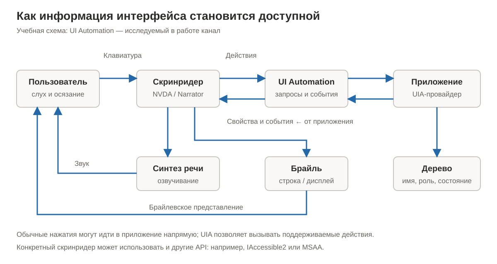

# Лабораторная работа № 1. Экранный доступ в Windows: от навигации к UI Automation

Дата материалов: 27.10.2026. Команда: Дмитрий Ярославов, Борисов Даниил, Чуров Александр, Иван Кожухин. Учебная группа и дисциплина не сообщены.

## Основание отчёта

Отчёт составлен по шести скриншотам команды и исходному коду тестовой формы. Ранее смоделированные результаты в этот отчёт не перенесены. Факт, видимый на снимке, отделён от предположения: изображения не содержат записи речи NVDA, последовательностей клавиш или журнала UI Automation.

## Участники и вклад

Ответственные за оформление разделов: Дмитрий Ярославов — среда и навигация; Борисов Даниил — брайлевский вывод; Чуров Александр — описание объектов; Иван Кожухин — схема и проверки.

## Часть 1. Невизуальная навигация

### Среда

| Параметр | Значение и основание |
|---|---|
| ОС | Windows 11 Pro, версия 26H2, сборка 26300.9711 — видны в «О системе» |
| NVDA | 2026.3 (2026.3.0.58174) — видно в окне «О NVDA» |
| Браузер | Microsoft Edge |
| Голос, синтезатор, клавиша NVDA | На снимках не показаны |
| Инспектор UIA | На предоставленных снимках не показан |


### Выбранные ресурсы

Использованы Bing (поиск «france football»), France Football (адресная строка `https://www.francefootball.fr`) и Transfermarkt. В Transfermarkt открыт раздел `https://www.transfermarkt.com/navigation/transfersundgeruechte`, затем поиск игрока и профиль с аудиопроизношением имени. На разных снимках присутствуют исходные английские и переведённые русские подписи, поэтому их нельзя считать неизменными между сеансами.


### Протокол по предоставленным материалам

В таблице представлены этапы работы и состояния на скриншотах. Точные клавиши и дословная речь не записаны.

| № | Действие/этап | Подтверждённое состояние | Что не зафиксировано |
|---|---|---|---|
| 1 | Ввод поискового запроса в Bing | В поле стоит «france football», раскрыты подсказки | Клавиши, речь, исполнитель |
| 2 | Переход в раздел Transfermarkt | Открыта страница «ТРАНСФЕРЫ И СЛУХИ» | Путь перехода, речь, исполнитель |
| 3 | Поиск игрока | В поле «Lamin Yamal», в выдаче одна строка «Lamine Yamal» | Как вводился запрос, речь |
| 4 | Просмотр профиля и аудио | Встроенный плеер показывает 0:03 / 0:03; на кнопке воспроизведения видна рамка | Факт слышимости звука, способ активации, речь NVDA |
| 5 | Открытие просмотрщика брайля | Поверх France Football открыто окно NVDA с брайлевской и текстовой строками | Клавиши открытия, речь, индивидуальный исполнитель |

### Таблица объектов

| Объект | Что видно | Роль / имя / состояние в UIA | Речь NVDA |
|---|---|---|---|
| Поиск Bing | «france football», подсказки | Не сняты | Не записана |
| Поиск Transfermarkt | «Lamin Yamal» | Не сняты | Не записана |
| Ссылка игрока | «Lamine Yamal», заметная рамка вокруг текста | Не сняты; рамка сама по себе не раскрывает свойства UIA | Не записана |
| Аудиоплеер | Кнопка воспроизведения, 0:03 / 0:03, громкость, меню | Не сняты | Не записана |
| Баннер cookies France Football | Текст и две кнопки: «oui j’accepte», «désactiver les finalités non essentielles» | Не сняты | Не записана |

### Брайлевский вывод


В просмотрщике NVDA видна текстовая строка `https://www.lequipe.fr/France-Football`; над ней показана последовательность брайлевских точек. Адрес в строке браузера — `https://www.francefootball.fr`: это другой контекст, и по снимку нельзя утверждать, что просмотрщик просто повторяет адресную строку. При этом в нижней строке браузера виден адрес статьи; он также не совпадает с отображаемой брайлевской строкой. Дословная речь для того же объекта не предоставлена, поэтому фактическое сравнение речи с брайлем остаётся незавершённым. Нельзя переносить в отчёт условные `edt` или `chk` из предыдущего примера: на этом снимке их нет.

### Архитектура



Пользователь работает устройством ввода; скринридер обрабатывает собственные команды и преобразует семантические данные интерфейса в речь и брайлевское представление. UI Automation позволяет клиенту запрашивать дерево, свойства и поддерживаемые действия, получать события от провайдера приложения. У NVDA существуют и другие каналы доступности; наличие UIA не доказывает, что конкретная реплика получена только через него.

## Часть 2. Исследование приложения

### Объект

В репозитории сохранена собственная HTML-форма (`before/index.html`, `after/index.html`), где можно изменить код. Публичные сайты части 1 не подменяют её: доступ к их исходному серверному коду у команды не заявлен. Скриншоты пользовательских сайтов не являются инспекцией этой локальной формы.

### Инспекция и события

Снимков Live Inspect/Inspect и Events/AccEvent в наборе нет. Для пяти элементов формы — `searchBtn`, `searchInput`, `name`, `volume`, `agree` — ControlType, Name, Value, IsEnabled, IsOffscreen, ToggleState, Patterns и родитель в дереве **не измерены в предоставленных материалах**. Имена и связи из HTML нельзя выдавать за выгрузку Windows UIA.

| Тип события | Подтверждение в материалах |
|---|---|
| FocusChanged | Нет журнала; видимая рамка на сайте не является записью события |
| PropertyChanged для Value | Нет журнала; заполненное поле не доказывает конкретный тип уведомления |
| WindowOpened | Нет журнала; открытое окно просмотрщика не доказывает регистрацию события |

### Два барьера, заложенные в исходном коде

1. Кнопка поиска: SVG скрыт через `aria-hidden="true"`, текста и aria-label в версии before нет → нет явного источника понятного доступного имени → пользователь может не понять назначение → проверить фокусом и инспектором в Windows.
2. Поле поиска: нет связанного label и aria-label → назначение не задано программной подписью → пользователь может не понять, что вводить → проверить `searchInput` в Windows.

Это выводы о собственном исходном коде. По предоставленным снимкам нельзя объявлять найденными те же дефекты на Transfermarkt, Bing или France Football.

### Исправление

До:

```html
<button id="searchBtn">
  <svg aria-hidden="true" width="20" height="20" viewBox="0 0 24 24">…</svg>
</button>
```

После:

```html
<button id="searchBtn" aria-label="Поиск">
  <svg aria-hidden="true" width="20" height="20" viewBox="0 0 24 24">…</svg>
</button>
```

Код исправления присутствует в репозитории. Снимков этой кнопки в Windows UIA до и после нет.

### Проверки и сравнение

Существующий `docs/BROWSER-CHECKS.json` содержит реальные автоматические проверки **Linux Chromium / Playwright**, не Windows/NVDA. В браузерном представлении before получен снимок `- button`, after — `- button "Поиск"`. Прошли ввод, ползунок, флажок, поиск, HTML-диалог, возврат фокуса, popup и проверка ширины 390 px. Результат проверки поля поиска в Windows и фактические реплики NVDA в эти данные не входят.

| Тест | Ожидание | Фактический статус |
|---|---|---|
| Позитивный: исправленная кнопка | Имя «Поиск», понятная речь, поиск работает | Браузерное имя и действие проверены; Windows UIA/NVDA не подтверждены |
| Негативный: неподписанное поле | Барьер сохраняется | По коду label/aria-label отсутствуют; Windows-проверка не предоставлена |

## Итоговый вывод

Предоставленные материалы показывают работу с несколькими веб-интерфейсами в Windows и открытый просмотрщик брайля NVDA. Версии среды установлены по снимку: Windows 11 Pro 26H2, сборка 26300.9711, и NVDA 2026.3. В просмотрщике отображается адрес `https://www.lequipe.fr/France-Football`, представленный брайлевскими точками и текстом. Из этого видно, что программа формирует отдельное представление информации об интерфейсе, но без записи речи нельзя провести полное сравнение двух каналов. Скринридеру доступны семантические имена, роли, значения и состояния элементов, которые не определяются только внешним видом. В исходном коде локальной формы добавление aria-label задаёт имя кнопки, не меняя иконку. Автоматическая проверка в Linux Chromium подтвердила изменение браузерного имени, однако она не заменяет UIA/NVDA-тест в Windows. Для завершения лабораторной по всем требованиям остаются нужны реальные протоколы клавиш и речи, свойства пяти элементов, журнал трёх типов событий и Windows-сравнение до и после.

## Источники

Шесть скриншотов, приложенных командой в текущем чате; исходники before/after; `docs/BROWSER-CHECKS.json`. Образец PDF использован только как ориентир структуры и не является источником результатов команды.


## Дополнение: предполагаемые результаты

Отсутствующие измерения дополнены ожидаемыми ролями, именами, состояниями, примерами речи и событий в [EXPECTED-RESULTS.md](docs/EXPECTED-RESULTS.md). Это предположения, а не измерения; в PDF они приведены на страницах 9–11.
